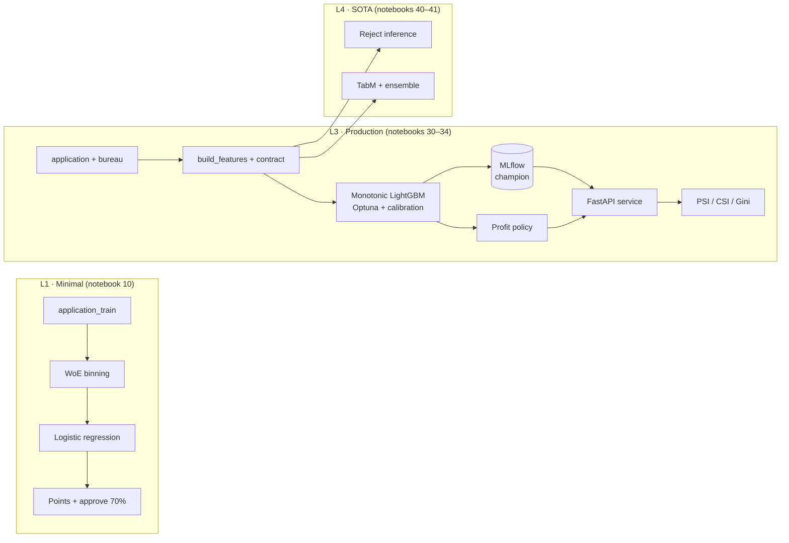

---
id: P1.01
title: "P1.01 · End-to-end credit decision engine"
---

# P1.01 · End-to-end credit decision engine

<!-- SUMMARY:START -->
| Domain | Recipes | Tiers | Colab runtime | Status | Last verified |
|---|---|---|---|---|---|
| credit | 12 | L1 · L3 · L4 | cpu | 🔍 review | — |
<!-- SUMMARY:END -->

> **In one sentence:** you end up with a complete application-decision system, from the raw file to a monitored decision, built in three tiers that show how much each step of complexity actually pays.

!!! info "About the numbers on this page"
    Result tables are generated from `results/*.full.json`, produced by running the notebooks in `full` mode on the real data. Until that run happens, the tables are empty. The notebooks also run on a **synthetic twin** (`OFFLINE=True`), used only for tests and CI: its numbers never appear here.

---

## 1. Business context

A lender receives personal-loan applications and must decide, for each one, to **approve or decline**, within seconds and in an explainable way. Erring one way costs defaults (the money does not come back); erring the other way costs revenue (a good client walks away).

- **Who decides:** the credit policy, approved by the credit committee and executed by the decision engine.
- **Who is affected:** the client, who has the right to request a review of an automated decision (Brazil's LGPD, art. 20), and the institution, which answers for risk and conduct.
- **Decision supported:** approve/decline the application, with PD, points score and reasons.
- **Typical starting point:** an old scorecard, manual rules and little visibility of performance after deployment.

## 2. Success metrics

| Type | Metric | Target | Note |
|---|---|---|---|
| Business | Realized profit per application | higher than the L1 policy | margin and LGD assumptions are parameters (notebook 32) |
| Business | Approval rate | ≥ 60% | commercial constraint |
| Business | Bad rate among approved | lower than L1 at the same approval rate | swap-set analysis |
| Technical | Test Gini | higher than L1, by more than the bootstrap deviation | primary ranking metric |
| Technical | ECE / Brier | PD calibrated enough for the profit formula | calibration chosen without touching test |
| Constraint | Training/serving parity | max PD difference < 1e-9 | tested in notebook 33 |
| Constraint | Explainability | 3 reasons per decision; monotonic relationships where the business requires | basis for review and audit |
| Constraint | Protected attributes | `CODE_GENDER` out of the model | used only for fairness checks |

## 3. Data

| Dataset | Content | Size | License | Limitations |
|---|---|---|---|---|
| Home Credit · `application_train.csv` | one application per row, ~120 columns (we use 43), target `TARGET` = payment difficulties | ~307k rows, 8% default rate | Kaggle competition rules | no application date: no out-of-time validation; only **granted** loans (see L4) |
| Home Credit · `bureau.csv` | the client's previous credits at other institutions | ~1.7M rows | Kaggle competition rules | no bureau for part of the clients; other currencies and relative dates |

**How to download:** create a Kaggle API token, accept the competition rules with the same account and store the token in Colab's `KAGGLE_API_TOKEN` secret. The loader `cookbook.home_credit.load("home-credit")` downloads and caches the files in `DATA_DIR`.

**Known biases:** the data comes from a specific operation (the competition's countries and period), with an unknown approval policy behind it. Conclusions about relative gains between techniques transfer better than absolute levels of Gini or default rate.

**Split:** 60/20/20 by client-ID *hash* (`hc.split`), stable across notebooks and downloads. `train` fits, `valid` decides (early stopping, hyperparameters, calibration, cut-off) and `test` only measures.

## 4. Architecture

### 4.1 Run order and artifacts

Run the notebooks in order, with the same `RUN_MODE` and `DATA_DIR`. Each one reads the previous artifacts from `DATA_DIR/artifacts/P1.01/<RUN_MODE>/`. On Colab, point `DATA_DIR` to a Google Drive folder so artifacts survive between sessions.

| Notebook | Reads | Writes |
|---|---|---|
| 10 · scorecard | raw data | `l1_scores.parquet`, `l1_scorecard_points.csv` |
| 30 · features | raw data | `features.parquet`, `feature_meta.json` |
| 31 · GBM | features, `l1_scores` | `lgbm.txt`, `calibrator.joblib`, `model_card.json`, `l3_predictions.parquet`, `mlflow.db` |
| 32 · policy | `l1_scores`, `l3_predictions` | `policy.json` |
| 33 · API | model, calibrator, policy, raw data | `serving/app.py`, `serving/Dockerfile`, `requirements.txt` |
| 34 · monitoring | features, model, raw data | — |
| 40 · rejects | features, `model_card.json` | — |
| 41 · TabM | features, `l3_predictions` | — |

Each notebook's results go to `results/` (in the working directory). On Colab, download the `*.full.json` files and put them in `docs/projects/P1-credit/P1.01-e2e-credit-decision-engine/results/` in the repository; `make render` updates the tables on this page.

## 5. L1 tier · Minimal version

**Goal:** WoE/IV scorecard with logistic regression, points table and an approve-70% rule, in one notebook.
**Notebook:** [10 · Minimal scorecard][nb10] [![Open in Colab][badge]][nb10]

1. Minimal cleaning: the `DAYS_EMPLOYED = 365243` sentinel becomes missing with a flag → recipe [N1.01 · Application scorecard with WoE/IV](../../../recipes/N-finance-economics/N1/N1.01-application-scorecard-woe-iv/index.md).
2. Two baselines: constant PD and the best single variable (`EXT_SOURCE_2`).
3. 19 interpretable candidate variables; `CODE_GENDER` is left out on purpose.
4. Optimal binning with a monotonic trend, WoE and an IV ≥ 0.02 filter (`optbinning`).
5. Logistic regression on WoE and a points scale: 600 points = 50:1 odds, +20 points double the odds.
6. Validation on test (Gini, KS, Brier with bootstrap) → recipes [N1.12 · Risk model validation](../../../recipes/N-finance-economics/N1/N1.12-risk-model-validation/index.md) and [D1.03 · Choose metrics](../../../recipes/D-classical-ml/D1/D1.03-choose-metrics/index.md).
7. Simple policy: approve the 70% with the lowest PD.
8. Pitfalls: binning fitted with the test set and the sentinel treated as a number.

<!-- RESULTS-L1:START -->
_No `full` results yet._
<!-- RESULTS-L1:END -->

## 6. L3 tier · Production

**Goal:** versioned features with a data contract, a calibrated and registered monotonic GBM, profit policy, an API with tested parity and PSI/CSI monitoring.

### 6.1 Feature pipeline

[30 · Feature pipeline][nb30] [![Open in Colab][badge]][nb30]

Feature engineering lives in the package (`cookbook.home_credit.build_features`) and is called **the same way** in training and in the API. It builds income-commitment ratios, implied term, age and employment length, combinations of the external scores, and 14 bureau aggregates computed with Polars → recipe [C2.06 · Aggregation and relational features](../../../recipes/C-analysis-features/C2/C2.06-aggregation-relational-features/index.md). A **data contract** blocks loads that break the rules (unique IDs, binary target, protected attributes out of the model, valid ranges), and the category vocabulary is frozen on training data. The variation axis measures what the bureau adds, and the pitfall shown is *target encoding* computed before the split.

### 6.2 Model

[31 · Calibrated monotonic GBM][nb31] [![Open in Colab][badge]][nb31]

LightGBM with **monotonic constraints** on the external scores, the annuity-to-income ratio and bureau delinquency, so the model is defensible → recipe [N1.02 · GBM scorecards with regulatory explainability](../../../recipes/N-finance-economics/N1/N1.02-gbm-scorecards-regulatory-explainability/index.md). Hyperparameters come from an Optuna (TPE) search with early stopping on validation. **Calibration** (identity, Platt or isotonic) is chosen by cross-validation inside the validation set, without touching test → recipe [D1.06 · Probability calibration](../../../recipes/D-classical-ml/D1/D1.06-probability-calibration/index.md). Each prediction carries three **reason codes** (exact tree SHAP contributions) → recipe [H3.01 · Model interpretability](../../../recipes/H-stats-causal/H3/H3.01-model-interpretability/index.md). The model, the calibrator and the metrics go to MLflow with the `champion` alias → recipe [G2.03 · Model registry](../../../recipes/G-mlops/G2/G2.03-model-registry/index.md).

Discarded decisions: *class weights* for imbalance (they distort calibration and usually do not improve Gini in GBMs) and *target encoding* of categories (LightGBM handles categories natively with the frozen vocabulary).

### 6.3 Decision policy

[32 · Expected-profit policy][nb32] [![Open in Colab][badge]][nb32]

The cut-off stops being "approve 70%" and instead maximizes realized profit, with a minimum approval rate of 60%. The formula uses exposure = `AMT_CREDIT`, a 10% margin on good loans and a 60% LGD on bad ones. These are **stated assumptions**, to be replaced with the portfolio's numbers → recipe [D1.07 · Thresholding and cost-sensitive decisions](../../../recipes/D-classical-ml/D1/D1.07-thresholding-cost-sensitive-decisions/index.md). The cut-off is chosen on validation and measured on test. The swap-set analysis, at the same approval rate, isolates the model gain; the policy table isolates the decision-rule gain.

### 6.4 Serving

[33 · Decision API][nb33] [![Open in Colab][badge]][nb33]

A FastAPI service takes the raw application and the bureau history and returns PD, score, decision, three reasons and the model version. The code is written to `serving/app.py` with a `Dockerfile` and tested with `TestClient`. The central test is **parity**: for the same clients, the API's PD must be identical to training's → recipes [G1.02 · Online inference API](../../../recipes/G-mlops/G1/G1.02-online-inference-api/index.md) and [G1.04 · Containerization](../../../recipes/G-mlops/G1/G1.04-containerization/index.md). Unknown categories become missing instead of breaking the API.

### 6.5 Monitoring

[34 · Monitoring][nb34] [![Open in Colab][badge]][nb34]

PD PSI, feature CSI, Gini and calibration-in-the-large under five controlled scenarios: no change, income +25%, younger population, `EXT_SOURCE_3` outage and bureau feed down → recipe [G3.02 · Drift detection](../../../recipes/G-mlops/G3/G3.02-drift-detection/index.md). The core lesson: **stability is not performance**. Economic shifts trigger CSI without ranking loss, while data failures can hurt Gini with the PD's PSI barely moving. That is why monitoring needs three layers: score, features and per-source quality.

<!-- RESULTS-L3:START -->
_No `full` results yet._
<!-- RESULTS-L3:END -->

## 7. L4 tier · SOTA

**Goal:** reject inference measured against ground truth and tabular deep learning (TabM) against and alongside the GBM.

### 7.1 Reject inference

[40 · Reject inference][nb40] [![Open in Colab][badge]][nb40]

Since the data only holds granted loans, we simulate an old policy that declines 30% and hide the outcome of declined clients. We compare KGB, hard cut-off, fuzzy augmentation and parceling against the **oracle**, a model that sees every label → recipe [N1.03 · Reject inference](../../../recipes/N-finance-economics/N1/N1.03-reject-inference/index.md). The simulation shows what is impossible to see in production: how much of the gap to the oracle each technique recovers and how wrong the PD is in the declined region. If no gain appears, the recommendation is to approve a small random fraction below the cut-off to obtain real labels.

### 7.2 Tabular deep learning

[41 · TabM vs the GBM][nb41] [![Open in Colab][badge]][nb41]

TabM (ICLR 2025), an efficient ensemble of MLPs, on the same L3 features, with a quantile transform and missing indicators → recipe [D2.14 · Tabular deep learning SOTA](../../../recipes/D-classical-ml/D2/D2.14-tabular-deep-learning-sota/index.md). We also measure a rank-average ensemble with LightGBM and the effect of the internal ensemble size (k = 1 is a plain MLP). In credit, ties between networks and GBMs are common. A gain, if any, must exceed the bootstrap deviation and pay for maintaining a second stack. A GPU on Colab is optional but speeds up `full` mode.

<!-- RESULTS-L4:START -->
_No `full` results yet._
<!-- RESULTS-L4:END -->

## 8. Risk, regulation and audit

| Risk | Impact | Mitigation | Recipe |
|---|---|---|---|
| Discrimination by protected attribute | harm to clients, sanctions, reputation | `CODE_GENDER` out of the model; measure approval and error rates per group | [M2.05 · Fairness](../../../recipes/M-technical-audit/M2/M2.05-fairness/index.md) |
| Using age as a variable | may be challenged as discriminatory | justify its use, monitor the effect by age band, document it in the model card | [H3.04 · Fairness and algorithmic bias](../../../recipes/H-stats-causal/H3/H3.04-fairness-algorithmic-bias/index.md) |
| Selection bias (only approved clients in training) | underestimated PD in the previously declined region | reject inference (L4) and a random sample below the cut-off | [N1.03 · Reject inference](../../../recipes/N-finance-economics/N1/N1.03-reject-inference/index.md) |
| Training/serving skew | wrong decisions with no visible error | same feature function, parity test in CI | [G1.02 · Online inference API](../../../recipes/G-mlops/G1/G1.02-online-inference-api/index.md) |
| Wrong economic assumptions | shifted optimal cut-off | sensitivity analysis (notebook 32), periodic review with finance | [D1.07 · Thresholding and cost-sensitive decisions](../../../recipes/D-classical-ml/D1/D1.07-thresholding-cost-sensitive-decisions/index.md) |
| Population shift or source failure | silent performance loss | PSI, CSI and per-source quality, with alerts | [G3.02 · Drift detection](../../../recipes/G-mlops/G3/G3.02-drift-detection/index.md) |
| Insufficient explanation of a decline | breach of the right to review | three reasons per decision, model version recorded in the response | [H3.01 · Model interpretability](../../../recipes/H-stats-causal/H3/H3.01-model-interpretability/index.md) |

**Applicable regulation (check it is still in force before relying on it):** Brazilian Law 13.709/2018 (LGPD), especially art. 20 (review of automated decisions); Law 12.414/2011 (positive credit bureau); CMN Resolution 4.557/2017 (risk management); CMN Resolution 4.966/2021 (financial instruments and expected loss); Consumer Protection Code.

**Audit checklist (Part M):**

- [ ] Split, calibration and cut-off decided without using test ([M2.02 · Validation protocol](../../../recipes/M-technical-audit/M2/M2.02-validation-protocol/index.md))
- [ ] Metrics with uncertainty intervals and comparison against a baseline ([M2.03 · Metrics and business alignment](../../../recipes/M-technical-audit/M2/M2.03-metrics-business-alignment/index.md))
- [ ] Protected attributes out of the model and effect measured per group ([M2.05 · Fairness](../../../recipes/M-technical-audit/M2/M2.05-fairness/index.md))
- [ ] Monotonic constraints documented and verified ([M2.06 · Explainability and documentation](../../../recipes/M-technical-audit/M2/M2.06-explainability-documentation/index.md))
- [ ] Independent re-run reproduces the results (`results/*.full.json`) ([M2.07 · Reproducibility](../../../recipes/M-technical-audit/M2/M2.07-reproducibility/index.md))
- [ ] Training/serving parity tested and model version traceable ([M2.10 · Post-deployment monitoring](../../../recipes/M-technical-audit/M2/M2.10-post-deployment-monitoring/index.md))
- [ ] Independent model validation before use ([N6.04 · Model risk management in finance](../../../recipes/N-finance-economics/N6/N6.04-model-risk-management-finance/index.md))

## 9. Recipes used

| Recipe | Where it fits |
|---|---|
| [N1.01 · Application scorecard with WoE/IV](../../../recipes/N-finance-economics/N1/N1.01-application-scorecard-woe-iv/index.md) | L1: WoE/IV scorecard |
| [N1.02 · GBM scorecards with regulatory explainability](../../../recipes/N-finance-economics/N1/N1.02-gbm-scorecards-regulatory-explainability/index.md) | L3: GBM with regulatory explainability |
| [N1.03 · Reject inference](../../../recipes/N-finance-economics/N1/N1.03-reject-inference/index.md) | L4: reject inference |
| [N1.12 · Risk model validation](../../../recipes/N-finance-economics/N1/N1.12-risk-model-validation/index.md) | L1 and L3: risk model validation |
| [D1.06 · Probability calibration](../../../recipes/D-classical-ml/D1/D1.06-probability-calibration/index.md) | L3: calibration |
| [D1.07 · Thresholding and cost-sensitive decisions](../../../recipes/D-classical-ml/D1/D1.07-thresholding-cost-sensitive-decisions/index.md) | L3: cut-off and cost-sensitive decision |
| [C2.06 · Aggregation and relational features](../../../recipes/C-analysis-features/C2/C2.06-aggregation-relational-features/index.md) | L3: bureau aggregates |
| [D2.14 · Tabular deep learning SOTA](../../../recipes/D-classical-ml/D2/D2.14-tabular-deep-learning-sota/index.md) | L4: tabular deep learning |
| [G1.02 · Online inference API](../../../recipes/G-mlops/G1/G1.02-online-inference-api/index.md) | L3: inference API |
| [G2.03 · Model registry](../../../recipes/G-mlops/G2/G2.03-model-registry/index.md) | L3: model registry |
| [G3.02 · Drift detection](../../../recipes/G-mlops/G3/G3.02-drift-detection/index.md) | L3: monitoring and drift |
| [H3.01 · Model interpretability](../../../recipes/H-stats-causal/H3/H3.01-model-interpretability/index.md) | L3: reason codes |

## 10. Extensions

- **More Home Credit sources:** `previous_application`, `installments_payments` and `credit_card_balance` usually add a lot of Gini (recipe C2.06).
- **Fairness with intervention:** measure and mitigate group differences with Fairlearn (recipes M2.05 and H3.04).
- **Tabular foundation models:** TabPFN instead of or next to TabM, on samples (recipe D2.14).
- **Risk-based pricing:** replace approve/decline with a rate per client (project P1.04).
- **IFRS 9 expected loss:** use the calibrated PD in stages and scenarios (project P1.02).
- **Full audit:** apply Part M to this model (project P1.09).

## 11. References

1. Home Credit Default Risk (competition and data). <https://www.kaggle.com/competitions/home-credit-default-risk>. Accessed 2026-11-04.
2. OptBinning documentation. <https://gnpalencia.org/optbinning/>. Accessed 2026-11-04.
3. LightGBM parameters (monotonic constraints). <https://lightgbm.readthedocs.io/en/latest/Parameters.html>. Accessed 2026-11-04.
4. Optuna documentation. <https://optuna.readthedocs.io/>. Accessed 2026-11-04.
5. MLflow documentation (tracking and model registry). <https://mlflow.org/docs/latest/>. Accessed 2026-11-04.
6. FastAPI, testing. <https://fastapi.tiangolo.com/tutorial/testing/>. Accessed 2026-11-04.
7. Gorishniy et al. *TabM: Advancing Tabular Deep Learning with Parameter-Efficient Ensembling*, ICLR 2025. <https://arxiv.org/abs/2410.24210>. Accessed 2026-11-04.
8. Law 13.709/2018 (LGPD). <https://www.planalto.gov.br/ccivil_03/_ato2015-2018/2018/lei/l13709.htm>. Accessed 2026-11-04.
9. Law 12.414/2011 (positive credit bureau). <https://www.planalto.gov.br/ccivil_03/_ato2011-2014/2011/lei/l12414.htm>. Accessed 2026-11-04.

[badge]: https://colab.research.google.com/assets/colab-badge.svg
[nb10]: https://colab.research.google.com/github/1thirteeng3/ds-ai-cookbook/blob/colab/en/projects/P1-credit/P1.01-e2e-credit-decision-engine/notebooks/10-minimal-scorecard.ipynb
[nb30]: https://colab.research.google.com/github/1thirteeng3/ds-ai-cookbook/blob/colab/en/projects/P1-credit/P1.01-e2e-credit-decision-engine/notebooks/30-feature-pipeline.ipynb
[nb31]: https://colab.research.google.com/github/1thirteeng3/ds-ai-cookbook/blob/colab/en/projects/P1-credit/P1.01-e2e-credit-decision-engine/notebooks/31-gbm-monotonic-calibrated.ipynb
[nb32]: https://colab.research.google.com/github/1thirteeng3/ds-ai-cookbook/blob/colab/en/projects/P1-credit/P1.01-e2e-credit-decision-engine/notebooks/32-decision-policy.ipynb
[nb33]: https://colab.research.google.com/github/1thirteeng3/ds-ai-cookbook/blob/colab/en/projects/P1-credit/P1.01-e2e-credit-decision-engine/notebooks/33-serving-api.ipynb
[nb34]: https://colab.research.google.com/github/1thirteeng3/ds-ai-cookbook/blob/colab/en/projects/P1-credit/P1.01-e2e-credit-decision-engine/notebooks/34-monitoring.ipynb
[nb40]: https://colab.research.google.com/github/1thirteeng3/ds-ai-cookbook/blob/colab/en/projects/P1-credit/P1.01-e2e-credit-decision-engine/notebooks/40-reject-inference.ipynb
[nb41]: https://colab.research.google.com/github/1thirteeng3/ds-ai-cookbook/blob/colab/en/projects/P1-credit/P1.01-e2e-credit-decision-engine/notebooks/41-tabular-deep-learning.ipynb
