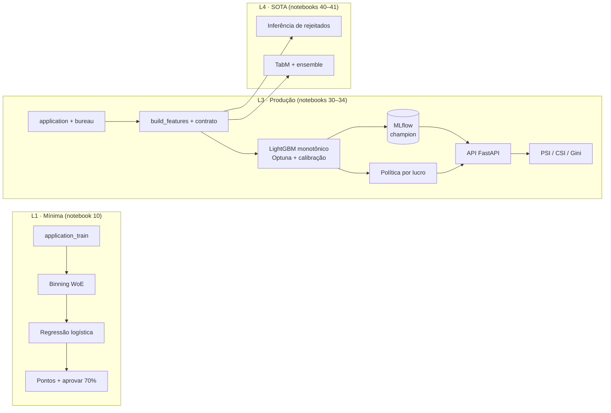

# P1.01 · Motor de concessão de crédito E2E

<!-- SUMMARY:START -->
| Domínio | Receitas | Camadas | Runtime Colab | Status | Última verificação |
|---|---|---|---|---|---|
| credit | 12 | L1 · L3 · L4 | cpu | 🔍 revisão | — |
<!-- SUMMARY:END -->

> **Em uma frase:** você termina com um sistema de concessão completo, do arquivo bruto à decisão monitorada, construído em três camadas que mostram quanto cada passo de complexidade realmente rende.

!!! info "Sobre os números desta página"
    As tabelas de resultados são geradas dos arquivos `results/*.full.json`, produzidos ao rodar os notebooks em modo `full` com a base real. Enquanto essa execução não for feita, as tabelas aparecem vazias. Os notebooks também rodam com um **gêmeo sintético** (`OFFLINE=True`), usado só para testes e CI: seus números nunca entram aqui.

---

## 1. Contexto de negócio

Uma financeira recebe pedidos de crédito pessoal e precisa decidir, para cada um, **aprovar ou recusar**, em segundos e de forma explicável. Errar para um lado custa inadimplência (o empréstimo não volta); errar para o outro custa receita (um bom cliente vai embora).

- **Quem decide:** a política de crédito, aprovada pelo comitê de crédito e executada pelo motor de decisão.
- **Quem é afetado:** o cliente, que tem direito de pedir revisão de uma decisão automatizada (LGPD, art. 20), e a instituição, que responde pelo risco e pela conduta.
- **Decisão apoiada:** aprovar/recusar o pedido, com PD, score em pontos e motivos.
- **Situação típica de partida:** um scorecard antigo, regras manuais e pouca visibilidade de desempenho depois da implantação.

## 2. Métricas de sucesso

| Tipo | Métrica | Meta | Observação |
|---|---|---|---|
| Negócio | Lucro realizado por pedido | maior que o da política L1 | premissas de margem e LGD são parâmetros (notebook 32) |
| Negócio | Taxa de aprovação | ≥ 60% | restrição comercial |
| Negócio | Inadimplência entre aprovados | menor que a L1 na mesma taxa de aprovação | análise de troca (*swap set*) |
| Técnica | Gini de teste | maior que o da L1, com diferença acima do desvio do *bootstrap* | métrica primária de ordenação |
| Técnica | ECE / Brier | PD calibrado o suficiente para a conta de lucro | calibração escolhida sem tocar no teste |
| Restrição | Paridade treino/serviço | diferença máxima de PD < 1e-9 | testada no notebook 33 |
| Restrição | Explicabilidade | 3 motivos por decisão; relações monotônicas onde o negócio exige | base para revisão e auditoria |
| Restrição | Atributos protegidos | `CODE_GENDER` fora do modelo | usado só para checar equidade |

## 3. Dados

| Base | Conteúdo | Tamanho | Licença | Limitações |
|---|---|---|---|---|
| Home Credit · `application_train.csv` | um pedido por linha, ~120 colunas (usamos 43), alvo `TARGET` = dificuldade de pagamento | ~307 mil linhas, 8% de inadimplência | regras da competição Kaggle | sem data do pedido: não há validação fora do tempo; só pedidos **concedidos** (ver L4) |
| Home Credit · `bureau.csv` | créditos anteriores do cliente em outras instituições | ~1,7 milhão de linhas | regras da competição Kaggle | sem bureau para parte dos clientes; valores de outras moedas e datas relativas |

**Como baixar:** crie um token de API no Kaggle, aceite as regras da competição com a mesma conta e guarde o token no segredo `KAGGLE_API_TOKEN` do Colab. O carregador `cookbook.home_credit.load("home-credit")` baixa e guarda os arquivos em `DATA_DIR`.

**Vieses conhecidos:** a base vem de uma operação específica (países e período da competição), com uma política de aprovação desconhecida por trás. Conclusões sobre ganhos relativos entre técnicas se transferem melhor do que níveis absolutos de Gini ou inadimplência.

**Split:** 60/20/20 por *hash* do ID do cliente (`hc.split`), estável entre notebooks e downloads. `train` ajusta, `valid` decide (parada antecipada, hiperparâmetros, calibração, ponto de corte) e `test` só mede.

## 4. Arquitetura

### 4.1 Ordem de execução e artefatos

Rode os notebooks na ordem, com o mesmo `RUN_MODE` e `DATA_DIR`. Cada um lê os artefatos do anterior em `DATA_DIR/artifacts/P1.01/<RUN_MODE>/`. No Colab, aponte `DATA_DIR` para uma pasta do Google Drive para que os artefatos sobrevivam entre sessões.

| Notebook | Lê | Grava |
|---|---|---|
| 10 · scorecard | base bruta | `l1_scores.parquet`, `l1_scorecard_points.csv` |
| 30 · features | base bruta | `features.parquet`, `feature_meta.json` |
| 31 · GBM | features, `l1_scores` | `lgbm.txt`, `calibrator.joblib`, `model_card.json`, `l3_predictions.parquet`, `mlflow.db` |
| 32 · política | `l1_scores`, `l3_predictions` | `policy.json` |
| 33 · API | modelo, calibrador, política, base bruta | `serving/app.py`, `serving/Dockerfile`, `requirements.txt` |
| 34 · monitoramento | features, modelo, base bruta | — |
| 40 · rejeitados | features, `model_card.json` | — |
| 41 · TabM | features, `l3_predictions` | — |

Os resultados de cada notebook vão para `results/` (na pasta corrente). No Colab, baixe os arquivos `*.full.json` e coloque-os em `docs/projects/P1-credit/P1.01-e2e-credit-decision-engine/results/` no repositório; `make render` atualiza as tabelas desta página.

## 5. Camada L1 · Versão mínima

**Objetivo:** scorecard WoE/IV com regressão logística, tabela de pontos e regra de aprovar 70%, em um notebook.
**Notebook:** [10 · Scorecard mínimo][nb10] [![Abrir no Colab][badge]][nb10]

1. Limpeza mínima: o sentinela `DAYS_EMPLOYED = 365243` vira ausente com flag → receita [N1.01 · Scorecard de concessão com WoE/IV](../../../recipes/N-finance-economics/N1/N1.01-application-scorecard-woe-iv/index.md).
2. Dois *baselines*: PD constante e a melhor variável isolada (`EXT_SOURCE_2`).
3. 19 variáveis candidatas interpretáveis; `CODE_GENDER` fica de fora de propósito.
4. Binning ótimo com tendência monotônica, WoE e filtro de IV ≥ 0,02 (`optbinning`).
5. Regressão logística sobre WoE e escala de pontos: 600 pontos = odds 50:1, +20 pontos dobram as odds.
6. Validação no teste (Gini, KS, Brier com *bootstrap*) → receitas [N1.12 · Validação de modelos de risco (backtesting, estabilidade)](../../../recipes/N-finance-economics/N1/N1.12-risk-model-validation/index.md) e [D1.03 · Escolher métricas](../../../recipes/D-classical-ml/D1/D1.03-choose-metrics/index.md).
7. Política simples: aprovar os 70% de menor PD.
8. Armadilhas: binning ajustado com o teste e o sentinela tratado como número.

<!-- RESULTS-L1:START -->
_Ainda sem resultados `full`._
<!-- RESULTS-L1:END -->

## 6. Camada L3 · Produção

**Objetivo:** features versionadas com contrato de dados, GBM monotônico calibrado e registrado, política por lucro, API com paridade testada e monitoramento PSI/CSI.

### 6.1 Pipeline de features

[30 · Pipeline de features][nb30] [![Abrir no Colab][badge]][nb30]

A engenharia de features mora no pacote (`cookbook.home_credit.build_features`) e é chamada **igual** no treino e na API. São razões de comprometimento de renda, prazo implícito, idade e tempo de emprego, combinações dos scores externos e 14 agregados do bureau calculados com Polars → receita [C2.06 · Features de agregação e relacionais](../../../recipes/C-analysis-features/C2/C2.06-aggregation-relational-features/index.md). Um **contrato de dados** bloqueia cargas que quebram regras (IDs únicos, alvo binário, atributos protegidos fora do modelo, faixas válidas), e o vocabulário das categorias é congelado no treino. O eixo de variação mede quanto o bureau acrescenta, e a armadilha demonstrada é o *target encoding* calculado antes do split.

### 6.2 Modelo

[31 · GBM monotônico calibrado][nb31] [![Abrir no Colab][badge]][nb31]

LightGBM com **restrições monotônicas** nos scores externos, na razão parcela/renda e nos atrasos do bureau, para que o modelo seja defensável → receita [N1.02 · Scorecard com GBM e explicabilidade regulatória](../../../recipes/N-finance-economics/N1/N1.02-gbm-scorecards-regulatory-explainability/index.md). Os hiperparâmetros vêm de uma busca com Optuna (TPE) e parada antecipada na validação. A **calibração** (identidade, Platt ou isotônica) é escolhida por validação cruzada dentro da validação, sem tocar no teste → receita [D1.06 · Calibração de probabilidades](../../../recipes/D-classical-ml/D1/D1.06-probability-calibration/index.md). Cada previsão traz três **códigos de motivo** (contribuições SHAP exatas de árvore) → receita [H3.01 · Interpretabilidade de modelos](../../../recipes/H-stats-causal/H3/H3.01-model-interpretability/index.md). O modelo, o calibrador e as métricas vão para o MLflow com alias `champion` → receita [G2.03 · Registro de modelos](../../../recipes/G-mlops/G2/G2.03-model-registry/index.md).

Decisões descartadas: *class weights* para desbalanceamento (distorcem a calibração e costumam não melhorar o Gini em GBMs) e *target encoding* de categorias (o LightGBM trata categorias nativamente com o vocabulário congelado).

### 6.3 Política de decisão

[32 · Política por lucro esperado][nb32] [![Abrir no Colab][badge]][nb32]

O corte deixa de ser "aprovar 70%" e passa a maximizar lucro realizado, com taxa de aprovação mínima de 60%. A conta usa exposição = `AMT_CREDIT`, margem de 10% para empréstimos bons e LGD de 60% para os ruins. São **premissas declaradas**, a substituir pelos números da carteira → receita [D1.07 · Ajuste de threshold e decisão sob custo](../../../recipes/D-classical-ml/D1/D1.07-thresholding-cost-sensitive-decisions/index.md). O corte é escolhido na validação e medido no teste. A análise de troca, com a mesma taxa de aprovação, isola o ganho do modelo; a tabela de políticas isola o ganho da regra de decisão.

### 6.4 Serving

[33 · API de decisão][nb33] [![Abrir no Colab][badge]][nb33]

Uma API FastAPI recebe o pedido bruto e o histórico de bureau e devolve PD, score, decisão, três motivos e a versão do modelo. O código é gravado em `serving/app.py` com um `Dockerfile` e testado com o `TestClient`. O teste central é a **paridade**: para os mesmos clientes, o PD da API precisa ser idêntico ao do treino → receitas [G1.02 · API de inferência online](../../../recipes/G-mlops/G1/G1.02-online-inference-api/index.md) e [G1.04 · Containerização](../../../recipes/G-mlops/G1/G1.04-containerization/index.md). Categorias desconhecidas viram ausentes em vez de quebrar a API.

### 6.5 Monitoramento

[34 · Monitoramento][nb34] [![Abrir no Colab][badge]][nb34]

PSI do PD, CSI das features, Gini e calibração no agregado sob cinco cenários controlados: sem mudança, renda +25%, população mais jovem, falha no `EXT_SOURCE_3` e bureau fora do ar → receita [G3.02 · Detectar data drift e concept drift](../../../recipes/G-mlops/G3/G3.02-drift-detection/index.md). A lição central: **estabilidade não é desempenho**. Mudanças econômicas disparam CSI sem perda de ordenação, enquanto falhas de dados podem derrubar o Gini com o PSI do PD quase parado. Por isso o monitoramento precisa de três camadas: score, features e qualidade por fonte.

<!-- RESULTS-L3:START -->
_Ainda sem resultados `full`._
<!-- RESULTS-L3:END -->

## 7. Camada L4 · SOTA

**Objetivo:** inferência de rejeitados medida contra gabarito e deep learning tabular (TabM) contra e junto com o GBM.

### 7.1 Inferência de rejeitados

[40 · Inferência de rejeitados][nb40] [![Abrir no Colab][badge]][nb40]

Como a base só tem empréstimos concedidos, simulamos uma política antiga que recusa 30% e escondemos o resultado dos recusados. Comparamos KGB, corte rígido, aumento *fuzzy* e parcelamento contra o **oráculo**, um modelo que vê todos os rótulos → receita [N1.03 · Inferência de rejeitados](../../../recipes/N-finance-economics/N1/N1.03-reject-inference/index.md). A simulação mostra o que é impossível ver em produção: quanto cada técnica recupera da distância até o oráculo e quanto erra o PD na região recusada. Se o ganho não aparecer, a recomendação é aprovar uma pequena fração aleatória abaixo do corte para obter rótulos reais.

### 7.2 Deep learning tabular

[41 · TabM contra o GBM][nb41] [![Abrir no Colab][badge]][nb41]

TabM (ICLR 2025), um ensemble eficiente de MLPs, nas mesmas features da L3, com transformação por quantis e indicadores de ausência → receita [D2.14 · Deep learning tabular SOTA](../../../recipes/D-classical-ml/D2/D2.14-tabular-deep-learning-sota/index.md). Também medimos o ensemble por média de postos com o LightGBM e o efeito do tamanho do ensemble interno (k = 1 equivale a um MLP comum). Em crédito, o empate entre redes e GBMs é comum. O ganho, se houver, precisa ficar acima do desvio do *bootstrap* e pagar o custo de manter uma segunda stack. GPU no Colab é opcional, mas acelera o modo `full`.

<!-- RESULTS-L4:START -->
_Ainda sem resultados `full`._
<!-- RESULTS-L4:END -->

## 8. Riscos, regulação e auditoria

| Risco | Impacto | Mitigação | Receita |
|---|---|---|---|
| Discriminação por atributo protegido | dano a clientes, sanção, reputação | `CODE_GENDER` fora do modelo; medir taxas de aprovação e erro por grupo | [M2.05 · Fairness](../../../recipes/M-technical-audit/M2/M2.05-fairness/index.md) |
| Uso de idade como variável | pode ser questionado como discriminatório | justificar o uso, monitorar efeito por faixa etária, documentar no cartão do modelo | [H3.04 · Equidade e viés algorítmico](../../../recipes/H-stats-causal/H3/H3.04-fairness-algorithmic-bias/index.md) |
| Viés de seleção (só aprovados no treino) | PD subestimado na região antes recusada | inferência de rejeitados (L4) e amostra aleatória abaixo do corte | [N1.03 · Inferência de rejeitados](../../../recipes/N-finance-economics/N1/N1.03-reject-inference/index.md) |
| Divergência treino/serviço | decisões erradas sem nenhum erro aparente | mesma função de features, teste de paridade no CI | [G1.02 · API de inferência online](../../../recipes/G-mlops/G1/G1.02-online-inference-api/index.md) |
| Premissas econômicas erradas | corte ótimo deslocado | análise de sensibilidade (notebook 32), revisão periódica com finanças | [D1.07 · Ajuste de threshold e decisão sob custo](../../../recipes/D-classical-ml/D1/D1.07-thresholding-cost-sensitive-decisions/index.md) |
| Mudança de população ou falha de fonte | perda silenciosa de desempenho | PSI, CSI e qualidade por fonte, com alertas | [G3.02 · Detectar data drift e concept drift](../../../recipes/G-mlops/G3/G3.02-drift-detection/index.md) |
| Explicação insuficiente de recusa | descumprimento do direito de revisão | três motivos por decisão, registro da versão do modelo na resposta | [H3.01 · Interpretabilidade de modelos](../../../recipes/H-stats-causal/H3/H3.01-model-interpretability/index.md) |

**Normas aplicáveis (confira a vigência antes de usar):** Lei 13.709/2018 (LGPD), especialmente o art. 20 (revisão de decisões automatizadas); Lei 12.414/2011 (Cadastro Positivo); Resolução CMN 4.557/2017 (gestão de riscos); Resolução CMN 4.966/2021 (instrumentos financeiros e perda esperada); Código de Defesa do Consumidor.

**Checklist de auditoria (Parte M):**

- [ ] Split, calibração e ponto de corte decididos sem usar o teste ([M2.02 · Protocolo de validação](../../../recipes/M-technical-audit/M2/M2.02-validation-protocol/index.md))
- [ ] Métricas com intervalo de incerteza e comparação contra *baseline* ([M2.03 · Métricas e alinhamento com o negócio](../../../recipes/M-technical-audit/M2/M2.03-metrics-business-alignment/index.md))
- [ ] Atributos protegidos fora do modelo e efeito medido por grupo ([M2.05 · Fairness](../../../recipes/M-technical-audit/M2/M2.05-fairness/index.md))
- [ ] Restrições monotônicas documentadas e verificadas ([M2.06 · Explicabilidade e documentação](../../../recipes/M-technical-audit/M2/M2.06-explainability-documentation/index.md))
- [ ] Reexecução independente reproduz os resultados (`results/*.full.json`) ([M2.07 · Reprodutibilidade](../../../recipes/M-technical-audit/M2/M2.07-reproducibility/index.md))
- [ ] Paridade treino/serviço testada e versão do modelo rastreável ([M2.10 · Monitoramento e operação pós-deploy](../../../recipes/M-technical-audit/M2/M2.10-post-deployment-monitoring/index.md))
- [ ] Validação independente do modelo antes do uso ([N6.04 · Gestão de risco de modelos no setor financeiro](../../../recipes/N-finance-economics/N6/N6.04-model-risk-management-finance/index.md))

## 9. Receitas utilizadas

| Receita | Onde entra |
|---|---|
| [N1.01 · Scorecard de concessão com WoE/IV](../../../recipes/N-finance-economics/N1/N1.01-application-scorecard-woe-iv/index.md) | L1: scorecard WoE/IV |
| [N1.02 · Scorecard com GBM e explicabilidade regulatória](../../../recipes/N-finance-economics/N1/N1.02-gbm-scorecards-regulatory-explainability/index.md) | L3: GBM com explicabilidade regulatória |
| [N1.03 · Inferência de rejeitados](../../../recipes/N-finance-economics/N1/N1.03-reject-inference/index.md) | L4: inferência de rejeitados |
| [N1.12 · Validação de modelos de risco (backtesting, estabilidade)](../../../recipes/N-finance-economics/N1/N1.12-risk-model-validation/index.md) | L1 e L3: validação de modelos de risco |
| [D1.06 · Calibração de probabilidades](../../../recipes/D-classical-ml/D1/D1.06-probability-calibration/index.md) | L3: calibração |
| [D1.07 · Ajuste de threshold e decisão sob custo](../../../recipes/D-classical-ml/D1/D1.07-thresholding-cost-sensitive-decisions/index.md) | L3: ponto de corte e decisão sob custo |
| [C2.06 · Features de agregação e relacionais](../../../recipes/C-analysis-features/C2/C2.06-aggregation-relational-features/index.md) | L3: agregados do bureau |
| [D2.14 · Deep learning tabular SOTA](../../../recipes/D-classical-ml/D2/D2.14-tabular-deep-learning-sota/index.md) | L4: deep learning tabular |
| [G1.02 · API de inferência online](../../../recipes/G-mlops/G1/G1.02-online-inference-api/index.md) | L3: API de inferência |
| [G2.03 · Registro de modelos](../../../recipes/G-mlops/G2/G2.03-model-registry/index.md) | L3: registro de modelos |
| [G3.02 · Detectar data drift e concept drift](../../../recipes/G-mlops/G3/G3.02-drift-detection/index.md) | L3: monitoramento e drift |
| [H3.01 · Interpretabilidade de modelos](../../../recipes/H-stats-causal/H3/H3.01-model-interpretability/index.md) | L3: códigos de motivo |

## 10. Extensões

- **Mais fontes do Home Credit:** `previous_application`, `installments_payments` e `credit_card_balance` costumam render bastante Gini (receita C2.06).
- **Fairness com intervenção:** medir e mitigar diferenças por grupo com Fairlearn (receitas M2.05 e H3.04).
- **Foundation models tabulares:** TabPFN no lugar ou ao lado do TabM, em amostras (receita D2.14).
- **Precificação por risco:** trocar aprovar/recusar por uma taxa por cliente (projeto P1.04).
- **Perda esperada IFRS 9:** usar o PD calibrado em estágios e cenários (projeto P1.02).
- **Auditoria completa:** aplicar a Parte M a este modelo (projeto P1.09).

## 11. Referências

1. Home Credit Default Risk (competição e dados). <https://www.kaggle.com/competitions/home-credit-default-risk>. Acesso em 2026-11-04.
2. OptBinning, documentação. <https://gnpalencia.org/optbinning/>. Acesso em 2026-11-04.
3. LightGBM, parâmetros (restrições monotônicas). <https://lightgbm.readthedocs.io/en/latest/Parameters.html>. Acesso em 2026-11-04.
4. Optuna, documentação. <https://optuna.readthedocs.io/>. Acesso em 2026-11-04.
5. MLflow, documentação (tracking e registro de modelos). <https://mlflow.org/docs/latest/>. Acesso em 2026-11-04.
6. FastAPI, testes. <https://fastapi.tiangolo.com/tutorial/testing/>. Acesso em 2026-11-04.
7. Gorishniy et al. *TabM: Advancing Tabular Deep Learning with Parameter-Efficient Ensembling*, ICLR 2025. <https://arxiv.org/abs/2410.24210>. Acesso em 2026-11-04.
8. Lei 13.709/2018 (LGPD). <https://www.planalto.gov.br/ccivil_03/_ato2015-2018/2018/lei/l13709.htm>. Acesso em 2026-11-04.
9. Lei 12.414/2011 (Cadastro Positivo). <https://www.planalto.gov.br/ccivil_03/_ato2011-2014/2011/lei/l12414.htm>. Acesso em 2026-11-04.

[badge]: https://colab.research.google.com/assets/colab-badge.svg
[nb10]: https://colab.research.google.com/github/1thirteeng3/ds-ai-cookbook/blob/colab/pt/projects/P1-credit/P1.01-e2e-credit-decision-engine/notebooks/10-minimal-scorecard.ipynb
[nb30]: https://colab.research.google.com/github/1thirteeng3/ds-ai-cookbook/blob/colab/pt/projects/P1-credit/P1.01-e2e-credit-decision-engine/notebooks/30-feature-pipeline.ipynb
[nb31]: https://colab.research.google.com/github/1thirteeng3/ds-ai-cookbook/blob/colab/pt/projects/P1-credit/P1.01-e2e-credit-decision-engine/notebooks/31-gbm-monotonic-calibrated.ipynb
[nb32]: https://colab.research.google.com/github/1thirteeng3/ds-ai-cookbook/blob/colab/pt/projects/P1-credit/P1.01-e2e-credit-decision-engine/notebooks/32-decision-policy.ipynb
[nb33]: https://colab.research.google.com/github/1thirteeng3/ds-ai-cookbook/blob/colab/pt/projects/P1-credit/P1.01-e2e-credit-decision-engine/notebooks/33-serving-api.ipynb
[nb34]: https://colab.research.google.com/github/1thirteeng3/ds-ai-cookbook/blob/colab/pt/projects/P1-credit/P1.01-e2e-credit-decision-engine/notebooks/34-monitoring.ipynb
[nb40]: https://colab.research.google.com/github/1thirteeng3/ds-ai-cookbook/blob/colab/pt/projects/P1-credit/P1.01-e2e-credit-decision-engine/notebooks/40-reject-inference.ipynb
[nb41]: https://colab.research.google.com/github/1thirteeng3/ds-ai-cookbook/blob/colab/pt/projects/P1-credit/P1.01-e2e-credit-decision-engine/notebooks/41-tabular-deep-learning.ipynb
