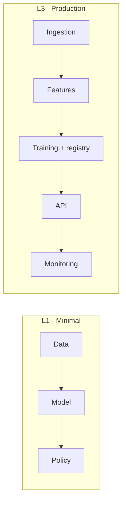

<!--
INTEGRATING PROJECT TEMPLATE (EN). Spec: SPEC.md §9.
- Same sections and order as index.pt.md. HTML comments are instructions: delete when filling in.
- Each tier (L1, L3, L4) must work on its own; L3 and L4 report measured gain over the previous tier.
-->

# <PID> · <Project title>

<!-- SUMMARY:START -->
| Domain | Recipes | Tiers | Colab runtime | Last verified |
|---|---|---|---|---|
| <domain> | n | L1 · L3 · L4 | cpu | — |
<!-- SUMMARY:END -->

> **In one sentence:** <the system you will have built by the end>.

---

## 1. Business context

<!-- Problem, actors (who decides, who is affected), decision supported, typical current state. -->

## 2. Success metrics

| Type | Metric | Target | Note |
|---|---|---|---|
| Business | <e.g. approval rate> | <...> | <...> |
| Technical | <e.g. OOT Gini> | <...> | <...> |
| Constraint | <e.g. p95 latency, interpretability, regulation> | <...> | <...> |

## 3. Data

<!-- Public datasets from project.yaml: what they represent, granularity, period, short dictionary, limitations, known biases and how they affect conclusions. -->

| Dataset | Content | Size | License | Limitations |
|---|---|---|---|---|
| <name> | <...> | <...> | <...> | <...> |

## 4. Architecture

## 5. L1 tier · Minimal version

**Goal:** <from project.yaml>
**Notebook:** 

1. <step> → recipe [<ID>](<link>)
2. <step>

<!-- RESULTS-L1:START -->
<!-- RESULTS-L1:END -->

## 6. L3 tier · Production

<!-- One subsection per 3x notebook. Explain engineering decisions, what was discarded and why. -->

### 6.1 <Feature pipeline>
### 6.2 <Model>
### 6.3 <Decision policy>
### 6.4 <Serving>
### 6.5 <Monitoring>

<!-- RESULTS-L3:START -->
<!-- RESULTS-L3:END -->

## 7. L4 tier · SOTA

<!-- Frontier techniques. Be honest: if there was no gain, say so and explain why. -->

<!-- RESULTS-L4:START -->
<!-- RESULTS-L4:END -->

## 8. Risk, regulation and audit

| Risk | Impact | Mitigation | Recipe |
|---|---|---|---|
| <e.g. regional bias> | <...> | <...> | [M2.05](<link>) |

**Applicable regulation:** <from project.yaml>

**Audit checklist (Part M):**
- [ ] <item>
- [ ] <item>

## 9. Recipes used

| Recipe | Where it fits |
|---|---|
| [<ID>](<link>) | <tier / step> |

## 10. Extensions

- <variation or next step>

## 11. References

1. <Title>. <URL>. Accessed <YYYY-MM-DD>.
