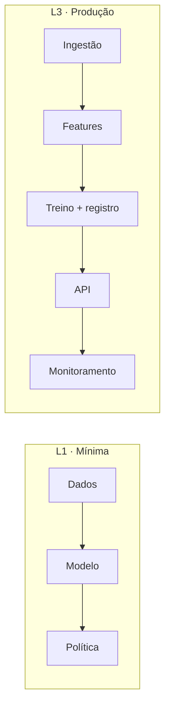

<!--
TEMPLATE DE PROJETO INTEGRADOR (PT-BR). Spec: SPEC.md §9.
- Mesmas seções e ordem do index.en.md. Comentários HTML são instruções: apague ao preencher.
- Cada camada (L1, L3, L4) precisa funcionar sozinha; L3 e L4 reportam ganho medido sobre a anterior.
-->

# <PID> · <Título do projeto>

<!-- SUMMARY:START -->
| Domínio | Receitas | Camadas | Runtime Colab | Última verificação |
|---|---|---|---|---|
| <domínio> | n | L1 · L3 · L4 | cpu | — |
<!-- SUMMARY:END -->

> **Em uma frase:** <o sistema que você terá construído ao final>.

---

## 1. Contexto de negócio

<!-- Problema, atores (quem decide, quem é afetado), decisão apoiada, situação atual típica. -->

## 2. Métricas de sucesso

| Tipo | Métrica | Meta | Observação |
|---|---|---|---|
| Negócio | <ex.: taxa de aprovação> | <...> | <...> |
| Técnica | <ex.: Gini OOT> | <...> | <...> |
| Restrição | <ex.: latência p95, interpretabilidade, norma> | <...> | <...> |

## 3. Dados

<!-- Bases públicas do project.yaml: o que representam, granularidade, período, dicionário resumido, limitações, vieses conhecidos e como isso afeta conclusões. -->

| Base | Conteúdo | Tamanho | Licença | Limitações |
|---|---|---|---|---|
| <nome> | <...> | <...> | <...> | <...> |

## 4. Arquitetura

## 5. Camada L1 · Versão mínima

**Objetivo:** <do project.yaml>
**Notebook:** 

1. <passo> → receita [<ID>](<link>)
2. <passo>

<!-- RESULTS-L1:START -->
<!-- RESULTS-L1:END -->

## 6. Camada L3 · Produção

<!-- Um subtítulo por notebook 3x. Explique decisões de engenharia e o que foi descartado e por quê. -->

### 6.1 <Pipeline de features>
### 6.2 <Modelo>
### 6.3 <Política de decisão>
### 6.4 <Serving>
### 6.5 <Monitoramento>

<!-- RESULTS-L3:START -->
<!-- RESULTS-L3:END -->

## 7. Camada L4 · SOTA

<!-- Técnicas de fronteira. Seja honesto: se não houve ganho, diga e explique. -->

<!-- RESULTS-L4:START -->
<!-- RESULTS-L4:END -->

## 8. Riscos, regulação e auditoria

| Risco | Impacto | Mitigação | Receita |
|---|---|---|---|
| <ex.: viés regional> | <...> | <...> | [M2.05](<link>) |

**Normas aplicáveis:** <do project.yaml>

**Checklist de auditoria (Parte M):**
- [ ] <item>
- [ ] <item>

## 9. Receitas utilizadas

| Receita | Onde entra |
|---|---|
| [<ID>](<link>) | <camada / etapa> |

## 10. Extensões

- <variação ou próximo passo>

## 11. Referências

1. <Título>. <URL>. Acesso em <YYYY-MM-DD>.
