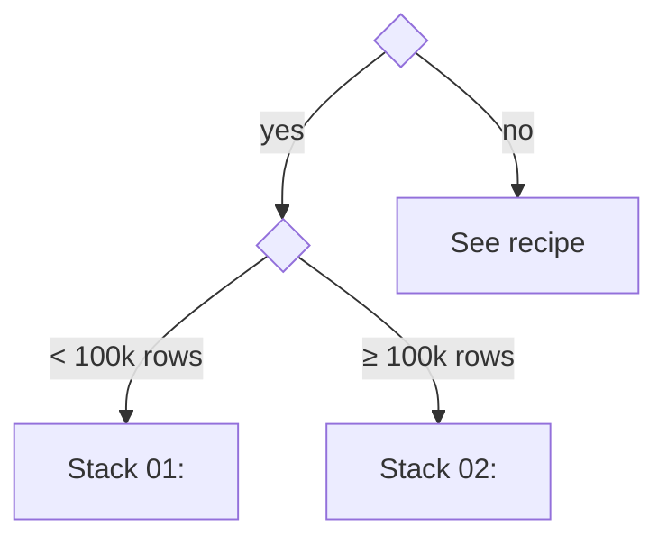

<!--
RECIPE TEMPLATE (EN). Spec: SPEC.md §7.
- Faithful translation of index.pt.md: same sections, same order, same anchors.
- HTML comments like this are instructions: delete them when filling in.
- Numbers (times, metrics) come from results/*.json. Never type results by hand.
-->

# <ID> · <Recipe title>

<!-- Summary box generated from recipe.yaml (tools/render_benchmarks.py). Do not edit between markers. -->
<!-- SUMMARY:START -->
| Entry level | Stacks | Colab runtime | Last verified |
|---|---|---|---|
| L? | n | cpu | — |
<!-- SUMMARY:END -->

> **In one sentence:** <the problem and what you will have at the end>.

**Prerequisites:** [<ID>](<link>) · [<ID>](<link>)
**Related:** [<ID>](<link>) · [<ID>](<link>)

---

## 1. Problem and context

<!--
- When does this problem show up in practice? Who faces it?
- Which decision does it support?
- Success criterion: technical metric + constraints (latency, cost, interpretability, regulation).
- 2–4 short paragraphs.
-->

**Success criterion:** <primary metric ≥ X, under constraints Y>.

## 2. Decision map

<!-- "If X then Y" flowchart leading the reader to the right stack. Each leaf is a stack or another recipe. -->



| If you... | Use | Why |
|---|---|---|
| <condition> | <stack> | <short reason> |

## 3. Candidate stacks

<!-- One row per stack in recipe.yaml, same order (L1 → L4). Cost/maturity/curve come from the YAML. -->

| Stack | Level | Pros | Cons | Use cases | Cost | Maturity | Learning curve |
|---|---|---|---|---|---|---|---|
| <name> | L1 | <...> | <...> | <...> | free | stable | low |

### 3.1 <Stack 01>
<!-- 1 paragraph: what it is, philosophy, where it shines, when to avoid it. -->

### 3.2 <Stack 02>

## 4. Step-by-step per stack

<!-- Summary of each notebook's steps. Details live in the notebook. Badge points to the colab branch, en version. -->

### 4.1 <Stack 01>

[](https://colab.research.google.com/github/<user>/ds-ai-cookbook/blob/colab/en/<recipe-path>/notebooks/01-<stack>.ipynb)

1. <step>
2. <step>
3. <step>

```python
# Essential snippet (≤ 15 lines) for readers who only want the core idea.
```

### 4.2 <Stack 02>

## 5. Variation axes

<!-- One subsection per axis in recipe.yaml. For each: values tested, effect chart/table, conditional recommendation. -->

### 5.1 <Axis name>

**Values tested:** <a, b, c> · **Notebook:** `notebooks/80-axis-<axis>.ipynb`


**Reading:** <what changed and by how much>.
**Recommendation:** <use a when..., b when...>.

## 6. Comparative benchmark

<!-- Table generated from results/*.full.json. Do not edit between markers. -->
<!-- BENCHMARK:START -->
| Stack | <primary metric> | <secondary> | Train (s) | Inference /1k (s) | Memory (MB) |
|---|---|---|---|---|---|
| baseline | — | — | — | — | — |
<!-- BENCHMARK:END -->

**How to read it:** <significant differences, ties, cost × quality trade-offs>.
**Conditions:** dataset <name>, runtime <cpu/gpu>, <k> folds/seeds, date <YYYY-MM-DD>.

## 7. Validation

- [ ] <check 1, e.g. out-of-time (OOT) metrics drop no more than X>
- [ ] <check 2>
- [ ] <check 3>

## 8. Pitfalls

<!-- At least 3. Fixed format. Point to the demonstrating notebook when there is one. -->

### 8.1 <Short pitfall name>
- **Symptom:** <what you observe>
- **Cause:** <why it happens>
- **Fix:** <what to do>
- **Demo:** `notebooks/0X-<stack>.ipynb`, section 6

### 8.2 <...>

### 8.3 <...>

## 9. From prototype to production

<!-- What changes at scale/in production: pipelines, deployment, monitoring, governance. Point to recipes in parts B, G, J, K, M. -->

| Aspect | In the notebook | In production | Recipe |
|---|---|---|---|
| <e.g. binning> | fitted on training data | versioned and frozen with the model | [G2.03](<link>) |

## 10. References

<!-- Same list as recipe.yaml, with access date. -->

1. <Title>. <URL>. Accessed <YYYY-MM-DD>.
