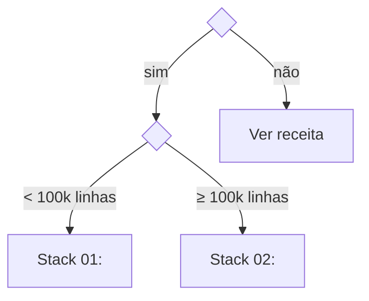

<!--
TEMPLATE DE RECEITA (PT-BR). Spec: SPEC.md §7.
- Mantenha todas as seções, na mesma ordem e com os mesmos títulos do index.en.md.
- Comentários HTML como este são instruções: apague-os ao preencher.
- Números (tempos, métricas) vêm de results/*.json. Não digite resultados à mão.
-->

# <ID> · <Título da receita>

<!-- Quadro-resumo gerado a partir do recipe.yaml (tools/render_benchmarks.py). Não edite entre os marcadores. -->
<!-- SUMMARY:START -->
| Nível de entrada | Stacks | Runtime Colab | Última verificação |
|---|---|---|---|
| L? | n | cpu | — |
<!-- SUMMARY:END -->

> **Em uma frase:** <o problema e o que você terá ao final>.

**Pré-requisitos:** [<ID>](<link>) · [<ID>](<link>)
**Relacionadas:** [<ID>](<link>) · [<ID>](<link>)

---

## 1. Problema e contexto

<!--
- Quando este problema aparece na prática? Quem o enfrenta?
- Qual decisão ele apoia?
- Critério de sucesso: métrica técnica + restrições (latência, custo, interpretabilidade, regulação).
- 2–4 parágrafos curtos.
-->

**Critério de sucesso:** <métrica primária ≥ X, com restrições Y>.

## 2. Mapa de decisão

<!-- Fluxograma "se X então Y" que leva o leitor à stack certa. Cada folha é uma stack ou outra receita. -->



| Se você... | Use | Por quê |
|---|---|---|
| <condição> | <stack> | <razão curta> |

## 3. Stacks candidatas

<!-- Uma linha por stack do recipe.yaml, mesma ordem (L1 → L4). Custo/maturidade/curva vêm do YAML. -->

| Stack | Nível | Pros | Contras | Casos de uso | Custo | Maturidade | Curva |
|---|---|---|---|---|---|---|---|
| <nome> | L1 | <...> | <...> | <...> | free | stable | low |

### 3.1 <Stack 01>
<!-- 1 parágrafo: o que é, filosofia, quando brilha, quando evitar. -->

### 3.2 <Stack 02>

## 4. Passo a passo por stack

<!-- Resumo dos passos de cada notebook. O detalhe está no notebook. Badge aponta para o branch colab, versão pt. -->

### 4.1 <Stack 01>

[](https://colab.research.google.com/github/<usuario>/ds-ai-cookbook/blob/colab/pt/<caminho-da-receita>/notebooks/01-<stack>.ipynb)

1. <passo>
2. <passo>
3. <passo>

```python
# Trecho essencial (≤ 15 linhas) para quem quer só a ideia central.
```

### 4.2 <Stack 02>

## 5. Eixos de variação

<!-- Um subtítulo por eixo do recipe.yaml. Para cada um: valores testados, gráfico/tabela do efeito, recomendação condicional. -->

### 5.1 <Nome do eixo>

**Valores testados:** <a, b, c> · **Notebook:** `notebooks/80-axis-<eixo>.ipynb`


**Leitura:** <o que mudou e quanto>.
**Recomendação:** <use a quando..., b quando...>.

## 6. Benchmark comparativo

<!-- Tabela gerada de results/*.full.json. Não edite entre os marcadores. -->
<!-- BENCHMARK:START -->
| Stack | <métrica primária> | <secundárias> | Treino (s) | Inferência /1k (s) | Memória (MB) |
|---|---|---|---|---|---|
| baseline | — | — | — | — | — |
<!-- BENCHMARK:END -->

**Como ler:** <diferenças significativas, empates, trade-offs custo × qualidade>.
**Condições:** dataset <nome>, runtime <cpu/gpu>, <k> folds/seeds, data <YYYY-MM-DD>.

## 7. Validação

- [ ] <checagem 1, ex.: métricas fora do tempo (OOT) não caem mais que X>
- [ ] <checagem 2>
- [ ] <checagem 3>

## 8. Armadilhas

<!-- ≥ 3. Formato fixo. Indique o notebook que demonstra, quando houver. -->

### 8.1 <Nome curto da armadilha>
- **Sintoma:** <o que você observa>
- **Causa:** <por que acontece>
- **Correção:** <o que fazer>
- **Demonstração:** `notebooks/0X-<stack>.ipynb`, seção 6

### 8.2 <...>

### 8.3 <...>

## 9. Do protótipo à produção

<!-- O que muda em escala/produção: pipelines, deploy, monitoramento, governança. Aponte receitas das partes B, G, J, K, M. -->

| Aspecto | No notebook | Em produção | Receita |
|---|---|---|---|
| <ex.: binning> | ajustado no treino | versionado e congelado com o modelo | [G2.03](<link>) |

## 10. Referências

<!-- Mesma lista do recipe.yaml, com data de acesso. -->

1. <Título>. <URL>. Acesso em <YYYY-MM-DD>.
